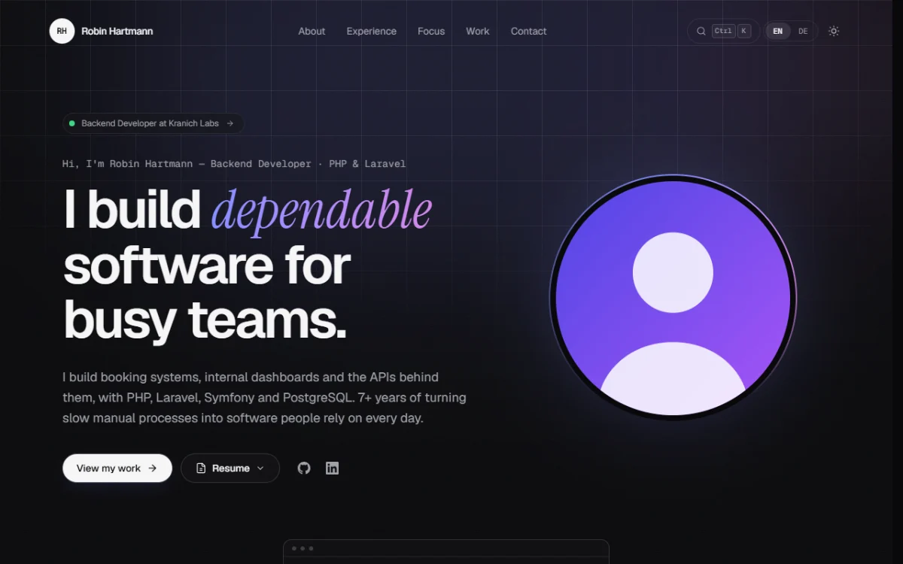
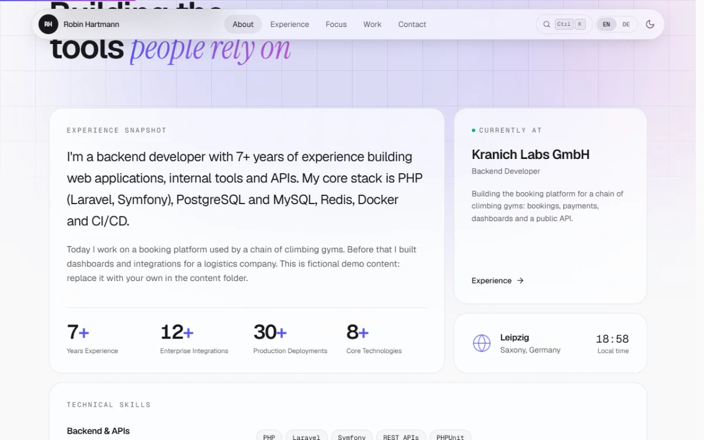

# Portfolio template

[](https://github.com/abdullahrather/abdullahrather.github.io/actions/workflows/deploy.yml)
[](./LICENSE)
[](https://github.com/abdullahrather/abdullahrather.github.io/releases)

A personal portfolio site for developers: who you are, where you've worked, what you've built, and a case-study page for each larger project. English and German, light and dark, fast, and free to host on GitHub Pages.

It ships with a fictional demo person, Robin Hartmann, so a fresh copy builds a complete site straight away. You replace one folder, `content/`, with your own details. The code doesn't need changing.

My own site, [abdullahrather.com](https://abdullahrather.com), runs on this repository with my content kept in a private repository.



| About | Projects |
|---|---|
|  |  |

| A case study |
|---|
|  |

## What you get

| Section | What it shows |
|---|---|
| **Hero** | Your headline, photo, resume download and links, and your case studies as a fan of windows |
| **About** | A summary, your current role, four figures, and skills grouped by what you use them for |
| **Experience** | Your work history, with durations worked out from the dates so they stay current |
| **Focus** | The kinds of work you do most |
| **Work** | Your projects in a grid that filters by type, with details in a dialog |
| **Case studies** | A page per larger project at `/work/<name>/`: the problem, what you built, how it works, the hard parts and screenshots |
| **Activity** | Optional: a six-month commit grid and the latest release and commit from your public GitHub repositories |
| **Contact** | A contact form, your email and profiles |

Around these:

- **Command menu:** `Ctrl+K` or `⌘K` jumps to a section or a case study, switches theme or language, copies your email or opens your resume.
- **Two languages and two themes,** following the visitor's browser and system until they pick.
- **Plain HTML first:** every page is rendered to HTML when the site is built, so it shows before JavaScript loads, search engines can read it, and it works with JavaScript off.
- **Accessible:** keyboard support, reduced motion, and automated accessibility checks on every change.
- **Privacy-friendly:** no analytics unless you add an ID, and then only after the visitor agrees.

## Make it yours

### 1. Copy the repository

Use **Use this template** on GitHub, or fork it. Name the copy **`<your-username>.github.io`**, or plan to use your own domain. The site is built to be served from the root of a domain, so a project address such as `<your-username>.github.io/portfolio/` won't load its styles.

### 2. Replace the content

Everything about the person behind the site is in `content/`:

| File | What it holds |
|---|---|
| `site.json` | Your name, address, email, location, time zone, links, resume files, figures and tech list |
| `en.json`, `de.json` | All text, in English and German. Change both |
| `facts.json` | Dates and links for your jobs, and the pictures, links and tech lists for your projects |
| `public/` | Your photo, resumes, screenshots, favicons, social image and privacy page |
| `email/` | Copies of the contact form's email templates, to paste into EmailJS |
| `activity.json` | The saved GitHub activity. Written by the deploy; no need to edit |

Then check it:

```bash
npm install
npm run check:content
npm run dev
```

`npm run check:content` lists anything missing or mismatched, such as text in one language only, a missing picture, or a bad date.

### 3. Turn on GitHub Pages

In your repository's **Settings → Pages**, set the source to **GitHub Actions**. Then push to `main`, or run the **Build & Deploy** workflow from the **Actions** tab. The workflow builds the site and hands it straight to GitHub Pages, so no built files are kept in the repository. Merging into `main` updates the site from then on, and it also rebuilds once a day.

For your own domain, set `url` in `site.json` to it, enter the domain under **Settings → Pages → Custom domain**, and add the DNS records with your domain provider.

## The settings in `site.json`

| Setting | What it does |
|---|---|
| `name`, `initials` | Shown in the navigation, footer, page titles and metadata |
| `url` | The site's address, without a trailing slash. Used for links, the sitemap and `robots.txt` |
| `email`, `location` | Shown in the contact section, and used by the contact form |
| `timezone`, `timezoneLabel` | Your local time in the About section and footer, such as `Europe/Berlin` and `CET / CEST` |
| `careerStart` | The date your career started, as `YYYY-MM-DD`. Years of experience are worked out from it |
| `portrait`, `portraitAvif` | Your photo, and an optional smaller AVIF copy for browsers that support it |
| `socialImage` | The 1200 × 630 picture shown when the site is shared |
| `shortDescription`, `person` | The description and details for search engines |
| `socials` | Your profiles. `id` can be `github`, `linkedin` or `xing`, which have icons |
| `resume` | Your resume file per language. Without a German one, the English one is used |
| `stats` | The three figures in the About section after years of experience. Their labels are in the language files |
| `stack` | The technologies in the moving band under the hero |
| `github` | Your GitHub user, for the activity section |
| `analyticsId` | A Google Analytics ID |

Some parts switch themselves off when left empty:

| Left empty | Result |
|---|---|
| `analyticsId` | No analytics, no cookie banner, and no "Cookie settings" link |
| `github` | No GitHub activity section |
| `portraitAvif` | Only `portrait` is used |
| The EmailJS secrets | The contact form shows a notice, and visitors use your email instead |

### Projects

Each project needs an entry in `facts.json` and text in both language files, matched by `id`.

- **The picture** is either `shot`, a screenshot saved as `name.webp` (1200px wide) and `name-640.webp` (640px wide), both 16:10, or `cover`, one of the drawn schematics: `platform`, `records`, `form`, `kanban`, `chart`, `auth`, `site` or `convert`.
- **A case study** needs `caseStudy: true` and a `screens` list in `facts.json`, and a `study` block in both language files with a caption per screenshot. The first three case studies also appear in the hero.
- **A GitHub link** marks a project as public; `#` marks it as private.

### Contact form

The form sends messages through [EmailJS](https://www.emailjs.com) and is protected by Google reCAPTCHA. Both have free plans. Create an EmailJS service and template (the copies in `content/email/` are a starting point), then add these repository secrets in **Settings → Secrets and variables → Actions**:

`VITE_EMAILJS_USER_ID`, `VITE_EMAILJS_SERVICE_ID`, `VITE_EMAILJS_TEMPLATE_NOTIFY`, `VITE_EMAILJS_NOTIFY_TO`, `VITE_RECAPTCHA_SITE_KEY`

For local development, put the same values in `.env`, as `.env.example` shows.

### Keep your content private

If you'd rather not have your content in a public repository, as I do:

1. Put your `content/` folder in a private repository of its own.
2. In the public repository, add the variable `CONTENT_REPO` (such as `you/portfolio-content`) and the secret `CONTENT_TOKEN`: a fine-grained token with read access to that repository's contents.
3. The deploy then checks out your content in place of the demo, checks it, and runs the browser checks on it before publishing. If it can't read it, the deploy stops and the live site stays as it is.
4. To rebuild when the content changes, add a workflow to the private repository that starts the public deploy. Mine runs `gh workflow run deploy.yml --repo <public repo>` with a token that has Actions access.
5. To work on it locally, clone it next to the code and set `CONTENT_DIR=../portfolio-content` in `.env`.

## How it works

```
 content/         ─┐
   site.json       │
   en.json, de.json├─▶ React components ─▶ npm run build ─▶ dist/index.html
   facts.json      │                                        dist/work/<name>/index.html
   public/        ─┘
                                                     GitHub Actions ─▶ GitHub Pages
```

- **Every page is plain HTML first.** The build renders the home page and each case study to its own HTML file, with the styles inside it. React then takes over for the interactive parts.
- **Content is separate from code.** The code names no one. The page header, sitemap and `robots.txt` are all written from the content folder.
- **Project pictures share one style.** Each project is a window on the same backdrop: a real screenshot, or a schematic drawn in the theme's colours.
- **GitHub activity is saved, not fetched live.** The deploy reads GitHub's public API and saves the result, so a visitor's browser never contacts GitHub.
- **Moving between pages is animated by the browser,** in browsers that support View Transitions. Others load the page normally.
- **No animation library.** All motion is CSS, and it's turned off for visitors who ask their system to reduce motion.

## Stack

| Part | Choice |
|---|---|
| Pages | React 19, built with Vite 8 and rendered to static HTML |
| Styles | Tailwind CSS 4, with the colours and fonts as tokens in `src/index.css` |
| Fonts | Geist, Geist Mono and Instrument Serif, served from the site itself |
| Contact form | EmailJS and Google reCAPTCHA, loaded only when someone starts typing |
| Statistics | Google Analytics, optional and only after consent |
| Hosting | GitHub Pages, deployed by GitHub Actions |
| Quality | ESLint, Prettier, Playwright and axe |

## Run it locally

You need Node.js 22 or newer.

```bash
npm install
npm run dev        # the site, while you work on it
npm run build      # the site as it's deployed, in dist/
npm run preview    # serves dist/
```

## Project structure

```
content/           Everything about the person behind the site (see above)
src/
  components/      One file per section, plus CaseStudy (the /work/<name>/ page) and Cover (project pictures)
  lib/             Languages, routes, theme, analytics and small hooks
  entry-server.jsx Renders a page to HTML during the build
  index.css        Colours, fonts and shared styles
scripts/
  build.mjs           Builds the site, writes every page as HTML, and the sitemap and robots.txt
  check-content.mjs   Checks the content folder
  content.mjs         Finds the content folder: content/, or the one CONTENT_DIR names
  fetch-activity.mjs  Saves the GitHub activity
tests/
  smoke.mjs        Browser and accessibility checks, with expectations read from the content folder
```

## Checks

Every pull request runs these against the demo content. The deploy runs the content check and the browser checks again against the content that is about to go live.

| Check | What it does | Run it |
|---|---|---|
| Lint | ESLint, with no warnings allowed | `npm run lint` |
| Format | Prettier | `npm run format:check` |
| Content | Both languages have the same text, and every fact, picture and case study lines up | `npm run check:content` |
| Build | Builds the site and renders every page | `npm run build` |
| Dependency audit | Fails on a high or critical vulnerability | `npm audit --audit-level=high` |
| Smoke and accessibility | Opens the built site in a browser: pages without JavaScript, filters, the command menu, both languages, phone width, cookie consent when analytics are on, and axe in both themes | `npm run build && npm run test:smoke` |
| Workflow lint | Checks the GitHub Actions files | CI only |

## Releases

Every merged pull request gets a version and a GitHub release: a patch by default, a minor release with the `release:minor` label, a major release with `release:major`, and none with `skip-release`.

## Contributing

Bug reports and fixes are welcome. See [CONTRIBUTING](./CONTRIBUTING.md), the [code of conduct](./CODE_OF_CONDUCT.md) and the [accessibility statement](./ACCESSIBILITY.md). Please report security problems privately, as the [security policy](./SECURITY.md) describes.

## License

The code and the demo content are under the [MIT licence](./LICENSE). See [NOTICE](./NOTICE.md) for my personal content in the repository's history, which is not.
