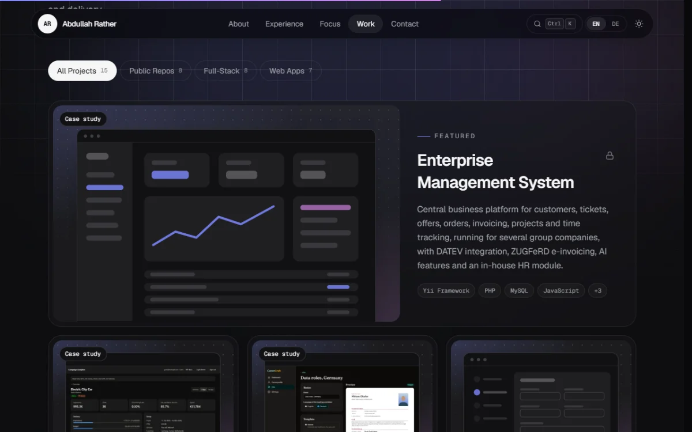
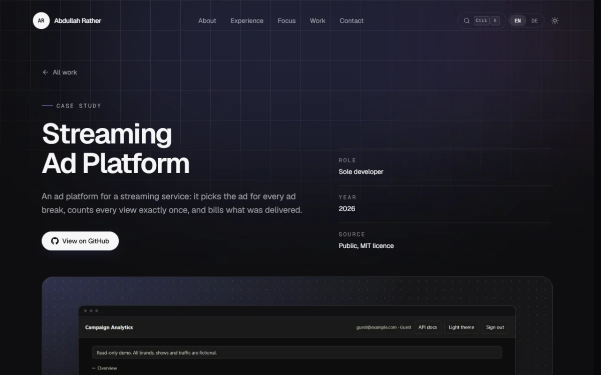
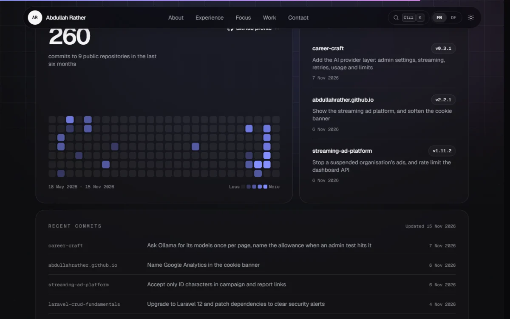

# Abdullah Rather — Portfolio

[](https://github.com/abdullahrather/abdullahrather.github.io/actions/workflows/deploy.yml)
[](./LICENSE)
[](https://github.com/abdullahrather/abdullahrather.github.io/releases)

My personal site, live at **[abdullahrather.com](https://abdullahrather.com)**. It shows who I am, where I've worked, and what I've built, with a case study for each of my larger projects. Everything is in English and German, with a light and a dark theme.

It's a static site: React pages turned into plain HTML when the site is built, hosted on GitHub Pages, with no server and no database.


| Projects | A case study |
|---|---|
|  |  |

| GitHub activity |
|---|
|  |

## What's on the site

| Section | What it shows |
|---|---|
| **Hero** | Who I am in one sentence, my resume in both languages, and the three case studies as a fan of windows |
| **About** | A short summary, my current role, and skills grouped by what I use them for |
| **Experience** | My work history, with durations worked out from the dates so they stay current |
| **Focus** | The six kinds of work I do most |
| **Work** | Fifteen projects in a grid that filters by type, with details in a dialog |
| **Case studies** | A page per larger project at `/work/<name>/`: the problem, what I built, how it works, the hard parts and screenshots |
| **Activity** | A six-month commit grid, and the latest release and commit from each of my public repositories |
| **Contact** | A contact form, and my email and profiles |

Around these:

- **Command menu:** `Ctrl+K` or `⌘K` jumps to a section or a case study, switches the theme or language, copies my email, or opens my resume.
- **Two languages:** English and German. The site follows the browser's language until someone picks one.
- **Two themes:** dark and light, following the system until someone picks one, with no flash on load.
- **Privacy:** Google Analytics loads only after a visitor agrees, and the [privacy page](https://abdullahrather.com/privacy/) says what is collected.

## How it works

```
 content/         ─┐
   site.json       │
   en.json, de.json├─▶ React components ─▶ npm run build ─▶ dist/index.html
   facts.json      │                                        dist/work/<name>/index.html
   public/        ─┘
                                                                        │
                                              GitHub Actions ─▶ GitHub Pages ─▶ abdullahrather.com
```

- **Every page is plain HTML first.** The build renders the home page and each case study to its own HTML file, with the styles inside it. The content shows before any JavaScript loads, search engines can read it, and it works with JavaScript turned off. React then takes over the page for the interactive parts.
- **Content is separate from code.** Everything about the person behind the site is in one `content/` folder: the name, links and keys in `site.json`, all text in two language files, dates and pictures in a facts file, and the photo, resumes and screenshots in `public/`. The code holds no personal details. A check fails the build when something in the folder is missing or the two languages don't match.
- **Project pictures share one style.** Each project is shown as a window: a real screenshot where the project can be shown, or a schematic drawn in the theme's colours where the code is private.
- **GitHub activity is saved, not fetched live.** A script reads GitHub's public API when the site is built and saves the result. The site rebuilds once a day to keep it fresh. A visitor's browser never contacts GitHub.
- **Moving between pages is animated by the browser.** Opening a case study fades the page and glides the project's picture into place, in browsers that support View Transitions. Others load the page normally.
- **No animation library.** All motion is CSS, and it's turned off for visitors who ask their system to reduce motion.

## Stack

| Part | Choice |
|---|---|
| Pages | React 19, built with Vite 8 and rendered to static HTML |
| Styles | Tailwind CSS 4, with the design's colours and fonts as tokens in `src/index.css` |
| Fonts | Geist, Geist Mono and Instrument Serif, served from the site itself |
| Contact form | EmailJS and Google reCAPTCHA, both loaded only when someone starts typing |
| Statistics | Google Analytics, only after consent |
| Hosting | GitHub Pages, deployed by GitHub Actions |
| Quality | ESLint, Prettier, Playwright and axe |

## Run it

You need Node.js 22 or newer.

```bash
npm install
npm run dev
```

Open the address it prints. To see the site as it's deployed:

```bash
npm run build
npm run preview
```

The contact form needs EmailJS and reCAPTCHA keys. Copy `.env.example` to `.env` and fill them in. Without them the form shows a notice, and everything else works.

`npm run activity` refreshes the saved GitHub activity. It needs no key.

## Project structure

```
content/           Everything about the person behind the site
  site.json          Name, address, email, links, time zone, analytics ID, resume files, tech list
  en.json, de.json   All text
  facts.json         Dates, links, pictures and tech lists for jobs and projects
  activity.json      The saved GitHub activity
  email/             Copies of the EmailJS email templates
  public/            Photo, resumes, screenshots, favicons and the privacy page
src/
  components/      One file per section, plus CaseStudy (the /work/<name>/ page) and Cover (project pictures)
  lib/             Languages, routes, theme, analytics and small hooks
  entry-server.jsx Renders a page to HTML during the build
  index.css        Colours, fonts and shared styles
scripts/
  build.mjs           Builds the site, writes every page as HTML, and writes the sitemap, robots.txt and CNAME
  check-content.mjs   Checks the content folder
  content.mjs         Finds the content folder
  fetch-activity.mjs  Saves the GitHub activity
tests/
  smoke.mjs        Browser and accessibility checks against the built site
```

## Editing content

- **Name, address and links** are in `content/site.json`. The sitemap, `robots.txt` and the custom-domain file are written from its `url` when the site is built.
- **Text** is in `content/en.json` and `content/de.json`. Change both.
- **Dates, links, pictures and tech lists** are in `content/facts.json`. Its lists match the language files by position, and projects match by `id`.
- **Files** such as the photo and resumes go in `content/public/`, and are served from the site's root.
- **A project's picture** is either `shot`, a screenshot saved as `name.webp` (1200px wide) and `name-640.webp` (640px wide), or `cover`, one of the schematics in `src/components/Cover.jsx`.
- **A case study** needs `caseStudy: true` and a `screens` list in the facts file, and a `study` block in both language files.

`npm run check:content` reports anything missing or mismatched.

To keep your content outside this repository, put the folder anywhere and set `CONTENT_DIR` to its path in `.env`.

## Checks

Every pull request runs these, and all must pass before it can be merged:

| Check | What it does | Run it |
|---|---|---|
| Lint | ESLint, with no warnings allowed | `npm run lint` |
| Format | Prettier | `npm run format:check` |
| Content | Both languages have the same text keys, and every fact, picture and case study lines up | `npm run check:content` |
| Build | Builds the site and renders every page | `npm run build` |
| Dependency audit | Fails on a high or critical vulnerability | `npm audit --audit-level=high` |
| Smoke and accessibility | Opens the built site in a browser: pages without JavaScript, filters, the command menu, both languages, phone width, cookie consent, and axe in both themes | `npm run build && npm run test:smoke` |
| Workflow lint | Checks the GitHub Actions files | CI only |

## Deploys and releases

Merging into `main` builds the site and publishes it to GitHub Pages. The same deploy runs once a day to refresh the GitHub activity.

Every merged pull request also gets a version and a GitHub release:

| Label on the pull request | Result |
|---|---|
| none | A patch release, such as `v3.1.0` to `v3.1.1` |
| `release:minor` | A minor release, for a new section or feature |
| `release:major` | A major release, for a redesign |
| `skip-release` | No release |

`v1.0.0` was the original site, `v2.0.0` the 2026 redesign, and `v3.0.0` added the case studies.

## Contributing

Bug reports and corrections are welcome. See [CONTRIBUTING](./CONTRIBUTING.md), the [code of conduct](./CODE_OF_CONDUCT.md) and the [accessibility statement](./ACCESSIBILITY.md). Please report security problems privately, as the [security policy](./SECURITY.md) describes.

## License

The code is under the [MIT licence](./LICENSE). My photo, resumes, written text and project screenshots are not: see [NOTICE](./NOTICE.md).
